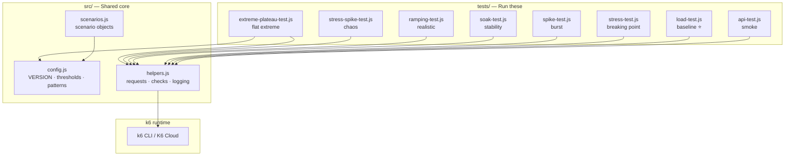
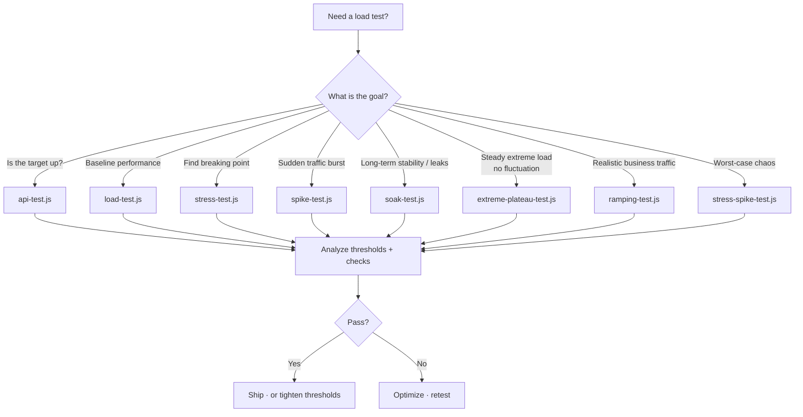
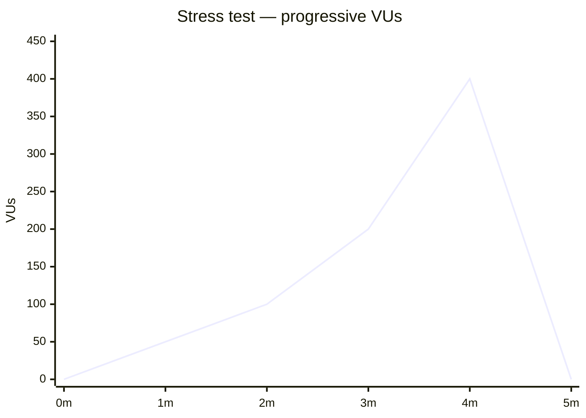
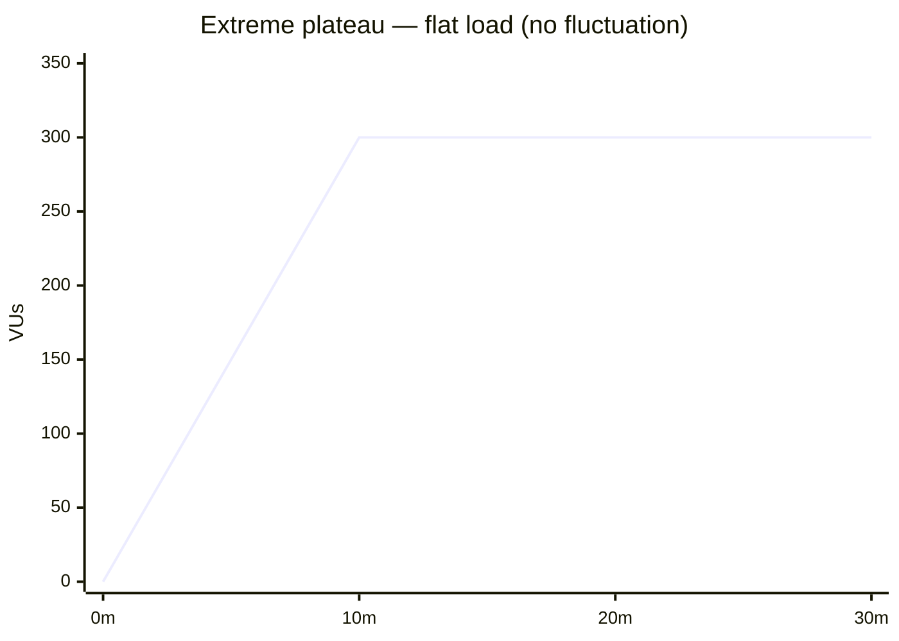
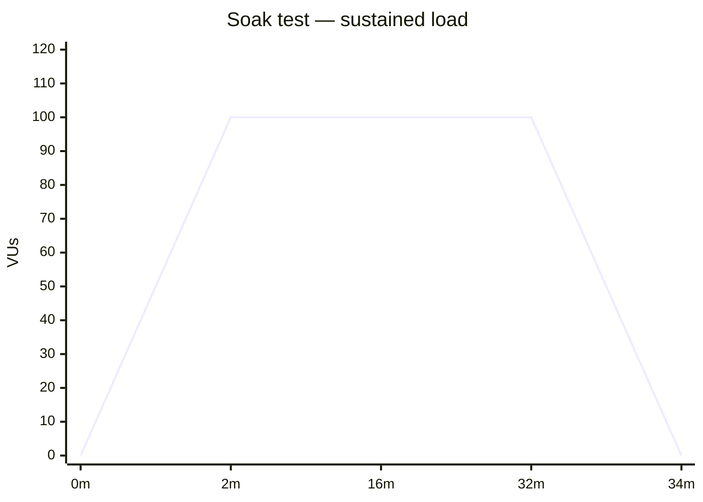
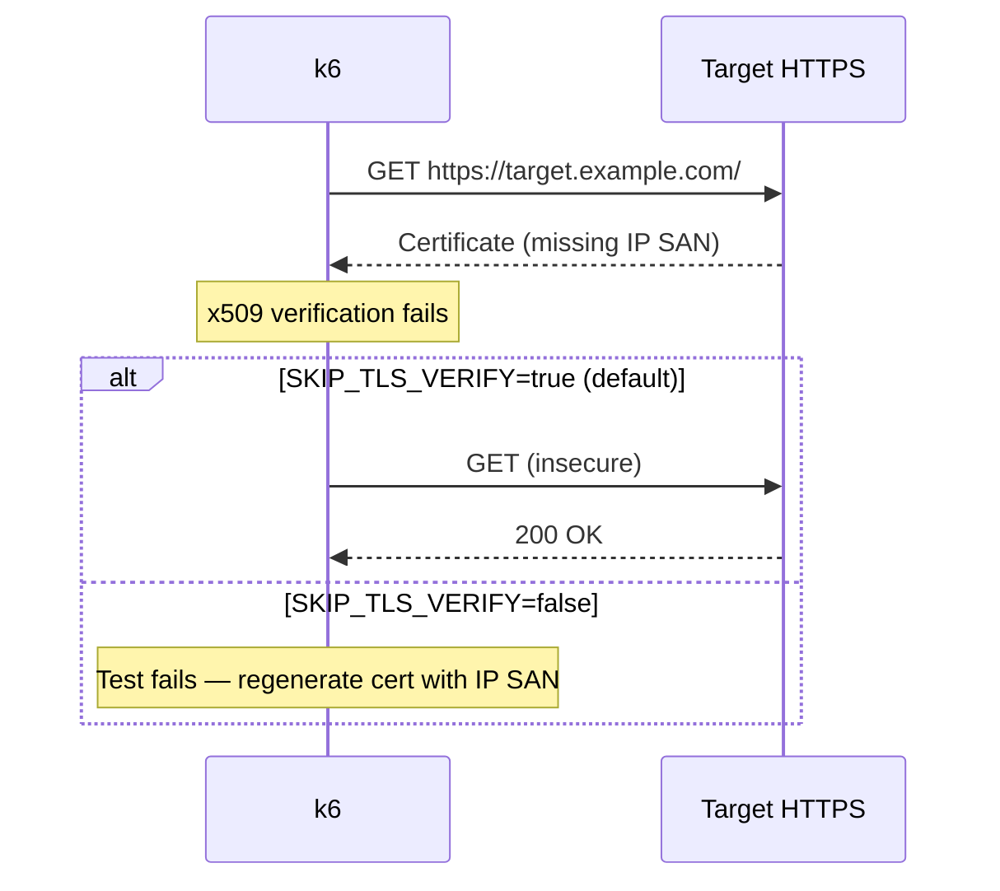
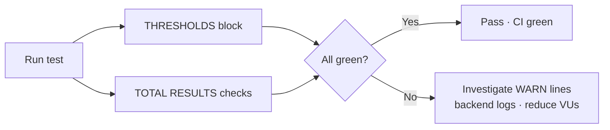

# 📊 K6 Load Testing Suite

**Version 2.1.0** — Professional load testing with K6: simple, scalable, and effective performance testing for your application.


---

## ⚠️ Disclaimer — Authorized Use Only

This repository and its scripts are provided **for authorized performance testing only**.

- Test **only** systems you own or have **explicit written permission** to test.
- Unauthorized access, load generation, or disruption of any system is **illegal** in most jurisdictions.
- Do not use this suite for scraping, abuse, credential attacks, or any illicit purpose.
- You are responsible for complying with applicable laws, contracts, and organizational policies.
- The authors and contributors accept **no liability** for misuse or damage arising from use of this software.

By running these scripts you confirm you have the right to test the configured `BASE_URL`.

---

## ⚡ 60-Second Quick Start

Works the same on **Windows**, **macOS**, and **Linux** (bash/sh shown; PowerShell noted where needed).

```bash
# 1. Install k6 (pick your OS — see docs/INSTALL.md for details)
# Debian/Ubuntu (Linux):
#   see docs/INSTALL.md → apt repository
# Fedora/RHEL (Linux):
#   sudo dnf install https://dl.k6.io/rpm/repo.rpm && sudo dnf install k6
# macOS:
#   brew install k6
# Windows:
#   choco install k6

# 2. Configure the target (dummy example — use your authorized target)
cp .env.example .env
# edit .env → BASE_URL=https://app.example.com/

# 3. Run a baseline test (any OS)
k6 run tests/load-test.js
# or: k6 run --env-file=.env tests/load-test.js
```

**Windows (PowerShell) equivalents**

```powershell
choco install k6          # or: winget install k6
Copy-Item .env.example .env
k6 run tests/load-test.js
k6 run --env-file=.env tests/load-test.js
```

✅ **That's it!** You are now running performance tests.

---

## 🏗️ Architecture



---

## 🧭 Which test should I run?



---

## 🧪 Test Suite

| Script | Peak VUs | Duration | Goal |
| :--- | --- | --- | --- |
| **`tests/api-test.js`** | 10 | 30s | **Smoke**: endpoints up, &lt; 500ms, status 200 |
| **`tests/load-test.js`** ⭐ | 20 | ~2m | **Baseline**: normal operations, p(95)&lt;500ms |
| **`tests/stress-test.js`** | 400 | ~5m | **Breaking point**: progressive load until failure |
| **`tests/spike-test.js`** | 500 | ~1.5m | **Burst**: sudden traffic surge |
| **`tests/soak-test.js`** | 100 | ~34m | **Stability**: memory leaks, long-term reliability |
| **`tests/ramping-test.js`** | 50 | ~4m | **Realistic**: multi-stage business-hours traffic |
| **`tests/stress-spike-test.js`** | 5000 | ~7.5m | **Chaos**: combined extreme + spike |
| **`tests/extreme-plateau-test.js`** | adjustable | adjustable | **Plateau**: hold extreme load steady, zero fluctuation |

Full details: **[docs/TESTS.md](./docs/TESTS.md)**

### Load profiles







---

## 🔒 TLS / Self-Signed Certificates

If requests fail with:

```text
x509: cannot validate certificate for target.example.com because it doesn't contain any IP SANs
```

the target serves HTTPS with a certificate that has no matching SAN (self-signed or hostname-only). This suite **skips TLS verification by default** (`SKIP_TLS_VERIFY=true`).

```bash
# Any OS — default (works for self-signed / IP targets)
k6 run tests/load-test.js --env BASE_URL=https://target.example.com/

# Any OS — strict TLS (production certs with valid SANs)
k6 run tests/load-test.js --env BASE_URL=https://app.example.com/ --env SKIP_TLS_VERIFY=false
```

Windows (PowerShell): same commands; line continuation uses a backtick instead of `\` if you split lines.



Long-term fix: regenerate the server cert with an IP SAN (see `docs/INSTALL.md`).

---

## 🧯 Extreme Plateau (no fluctuation)

`tests/extreme-plateau-test.js` holds heavy load **flat** — no ramp steps, no ramp-down — to measure stability at the limit.

| Env var | Default | Meaning |
| --- | --- | --- |
| `TARGET_VUS` | `300` | Extreme load level |
| `EXTREME_DURATION` | `10m` | How long to hold it |
| `RAMP_IN` | `0s` | Optional entry ramp; `0` = pure `constant-vus` |

```bash
# Linux / macOS / Windows (Git Bash, WSL, etc.)
k6 run tests/extreme-plateau-test.js \
  --env BASE_URL=https://app.example.com/ \
  --env TARGET_VUS=300 \
  --env EXTREME_DURATION=15m
```

```powershell
# Windows (PowerShell)
k6 run tests/extreme-plateau-test.js `
  --env BASE_URL=https://app.example.com/ `
  --env TARGET_VUS=300 `
  --env EXTREME_DURATION=15m
```

---

## 📁 Project Structure

```
k6/
├── 🔧 src/                  # Reusable core logic
│   ├── config.js           # VERSION, config, thresholds, patterns, option builders
│   ├── helpers.js          # Requests, verification, think time, logging
│   └── scenarios.js        # Pre-configured k6 scenario objects
│
├── 🧪 tests/                # Test scripts (run these)
│   ├── api-test.js
│   ├── load-test.js
│   ├── stress-test.js
│   ├── spike-test.js
│   ├── soak-test.js
│   ├── ramping-test.js
│   ├── stress-spike-test.js
│   └── extreme-plateau-test.js
│
├── 📚 docs/                 # Documentation
│   ├── INSTALL.md          # Install + full guide + troubleshooting
│   ├── TESTS.md            # Per-script reference
│   ├── CONFIGURATION.md    # Env vars, module APIs
│   ├── QUICK_REFERENCE.md  # Fast command lookup
│   └── REPOSITORY.md       # Repo description draft for GitHub
│
├── CHANGELOG.md            # Version history
├── VERSION                 # Current version: 2.1.0
├── .env.example            # Environment variables template
└── .gitignore
```

---

## ⚙️ Configuration

```bash
cp .env.example .env
```

| Variable | Default | Description |
| --- | --- | --- |
| `BASE_URL` | `http://localhost:3000` | Target URL |
| `TIMEOUT` | `30s` | HTTP request timeout |
| `THINK_TIME_MIN` / `THINK_TIME_MAX` | `1` / `3` | Think time range (seconds) |
| `SKIP_TLS_VERIFY` | `true` | Skip TLS cert verification |
| `TARGET_VUS` | `300` | Extreme plateau load level |
| `EXTREME_DURATION` | `10m` | Extreme plateau hold time |
| `RAMP_IN` | `0s` | Extreme plateau optional ramp-in |

```bash
k6 run --env-file=.env tests/load-test.js
k6 run tests/soak-test.js --env BASE_URL=https://app.example.com --env SKIP_TLS_VERIFY=false
```

Full reference: **[docs/CONFIGURATION.md](./docs/CONFIGURATION.md)**

---

## 📈 Understanding Results

- **`http_req_duration`** — `p(95)` = 95% of requests finished faster than this
- **`http_req_failed`** — percentage of failed requests
- **Thresholds (✓/✗)** — pass/fail gates per test type in `src/config.js`
- **Checks** — application-level assertions in TOTAL RESULTS



---

## 🔗 Documentation

| Document | Contents |
| --- | --- |
| [docs/INSTALL.md](./docs/INSTALL.md) | Installation, running tests, troubleshooting, FAQ |
| [docs/TESTS.md](./docs/TESTS.md) | Every script: profile, thresholds, when to use |
| [docs/CONFIGURATION.md](./docs/CONFIGURATION.md) | Env vars, module APIs, TLS, versioning |
| [docs/QUICK_REFERENCE.md](./docs/QUICK_REFERENCE.md) | One-page command lookup |
| [docs/REPOSITORY.md](./docs/REPOSITORY.md) | Repository description draft |
| [CHANGELOG.md](./CHANGELOG.md) | Version history |
| Official K6 docs | [k6.io/docs](https://k6.io/docs/) |
