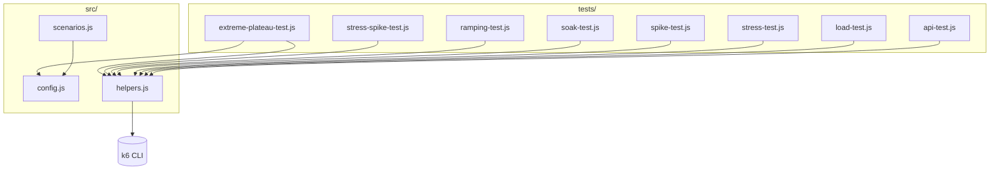
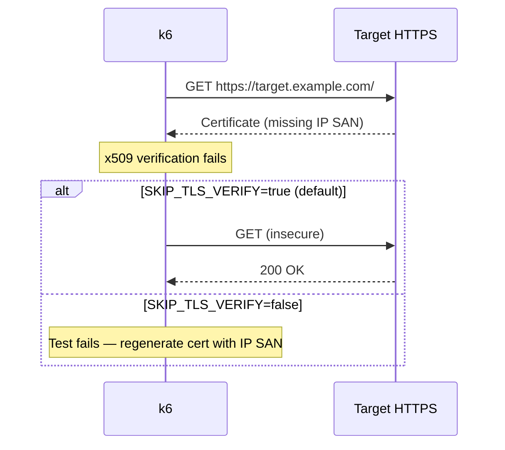
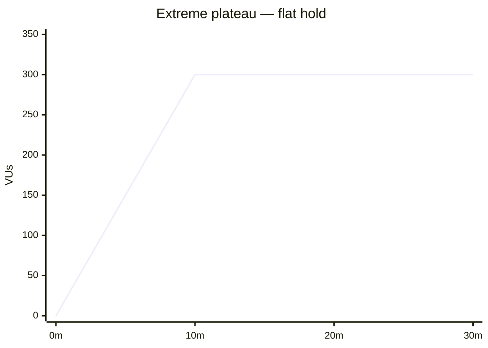

# 📊 K6 Load Testing Suite — Installation & Guide

**Version**: 2.1.0
**Status**: ✅ Production Ready


> ⚠️ **Disclaimer — Authorized use only.** Test only systems you own or have explicit written permission to test. Unauthorized load generation or access is illegal. Full notice: [README](../README.md#disclaimer--authorized-use-only).

---

## 📑 Table of Contents

1. [Quick Start](#-quick-start)
2. [What is K6?](#-what-is-k6)
3. [Installation Guide](#-installation-guide)
4. [Project Structure](#-project-structure)
5. [Configuration](#-configuration)
6. [TLS & Self-Signed Certificates](#-tls--self-signed-certificates)
7. [Running Tests](#-running-tests)
8. [Test Types Guide](#-test-types-guide)
9. [Understanding Results](#-understanding-results)
10. [Advanced Usage](#-advanced-usage)
11. [Troubleshooting](#-troubleshooting)
12. [Best Practices](#-best-practices)
13. [FAQ](#-faq)

---

## 🚀 Quick Start

Commands below are **bash/sh** (Linux, macOS, Windows Git Bash / WSL / MSYS).  
**Windows PowerShell** equivalents are shown in the next block.

```bash
# 1. Install k6 — Linux / macOS (see Installation Guide for full options)
# Debian/Ubuntu:  apt repository (see below)
# Fedora/RHEL:    sudo dnf install https://dl.k6.io/rpm/repo.rpm && sudo dnf install k6
# macOS:          brew install k6
# Windows:        choco install k6  (or winget install k6)

# 2. Navigate to this directory
cd k6

# 3. Copy environment file
cp .env.example .env
# Set BASE_URL in .env to your authorized target (dummy: https://app.example.com/)

# 4. Run your first test
k6 run tests/load-test.js
# or: k6 run --env-file=.env tests/load-test.js
# or: k6 run tests/load-test.js --env BASE_URL=http://localhost:3000
```

**Windows (PowerShell)**

```powershell
choco install k6          # or: winget install k6
Set-Location k6
Copy-Item .env.example .env
k6 run tests/load-test.js
k6 run --env-file=.env tests/load-test.js
```

**That's it!** You'll see live results in your terminal on any supported OS.

---

## 🤔 What is K6?

**K6** is a modern, open-source load testing tool designed for developers and DevOps engineers who want to identify performance bottlenecks before they affect users.

| Feature | Benefit |
| --- | --- |
| **JavaScript** | Write tests in familiar JavaScript, not XML |
| **Developer-First** | Built for developers by developers |
| **Scalable** | Laptop to thousands of VUs, or K6 Cloud |
| **Real Results** | Accurate metrics and realistic load simulation |

### Key use cases

1. Baseline testing
2. Capacity planning / breaking points
3. Regression detection
4. Long-term stability (soaks)
5. Burst / spike resilience
6. Extreme-load stability plateaus

---

## 💾 Installation Guide

### Prerequisites

- **Linux**, **Windows**, or **macOS**
- 2GB RAM minimum (4GB+ recommended; more for high VU counts)
- Network access for initial setup
- `curl` or a package manager on your OS

### Method 1: Official installers (recommended)

#### Linux (Debian / Ubuntu / Mint)

```bash
sudo gpg -k
sudo gpg --no-default-keyring \
  --keyring /usr/share/keyrings/k6-archive-keyring.gpg \
  --keyserver hkp://keyserver.ubuntu.com:80 \
  --recv-keys C5AD17C747E3415A3642D57D77C6C491D6AC1D69
echo "deb [signed-by=/usr/share/keyrings/k6-archive-keyring.gpg] https://dl.k6.io/deb stable main" \
  | sudo tee /etc/apt/sources.list.d/k6-stable.list
sudo apt-get update
sudo apt-get install k6
```

#### Linux (Fedora / RHEL / CentOS Stream)

```bash
sudo dnf install https://dl.k6.io/rpm/repo.rpm
sudo dnf install k6
# Older systems: sudo yum install https://dl.k6.io/rpm/repo.rpm && sudo yum install k6
```

#### Linux (Arch / Manjaro — AUR)

```bash
# Using an AUR helper (yay / paru)
yay -S k6
# or: paru -S k6
```

#### Linux (openSUSE)

```bash
# Binary download or Docker is the most reliable path (see Methods 2–3)
```

#### Linux (snap)

```bash
sudo snap install k6
```

#### macOS (Homebrew)

```bash
brew install k6
```

#### Windows (Chocolatey)

```powershell
choco install k6
```

#### Windows (winget)

```powershell
winget install k6
```

### Method 2: Docker (any OS — including Linux servers/CI)

```bash
docker pull grafana/k6:latest

# Run with the repo mounted (bash / Linux / macOS / Git Bash)
docker run -i -v "$(pwd)":/scripts grafana/k6 run /scripts/tests/load-test.js
docker run -e BASE_URL=https://app.example.com -i grafana/k6 run /scripts/tests/load-test.js

# Linux host with env file
docker run -i --env-file .env -v "$(pwd)":/scripts grafana/k6 run /scripts/tests/load-test.js
```

Windows (PowerShell) mount path:

```powershell
docker run -i -v "${PWD}:/scripts" grafana/k6 run /scripts/tests/load-test.js
```

### Method 3: Manual download (Linux, Windows, macOS)

1. https://github.com/grafana/k6/releases
2. Download the archive for your OS/arch (`amd64` / `arm64`)
3. Extract and place `k6` on your `PATH`
4. Verify: `k6 version`

**Linux example:**

```bash
tar -xzf k6-*.tar.gz
sudo cp k6-*/k6 /usr/local/bin/k6
k6 version
```

### Verify installation

```bash
k6 version
# e.g. k6 v1.5.0 (commit ...)
```

On Windows: `k6 version` in PowerShell or cmd after install.

---

## 📁 Project Structure



```
k6/
│
├── 🔧 src/                      # Shared core logic
│   ├── config.js               # VERSION, config, thresholds, patterns, option builders
│   ├── helpers.js              # makeRequest, verifyResponse, randomThinkTime, logMetric, ...
│   └── scenarios.js            # Reusable k6 scenario objects
│
├── 🧪 tests/                    # Test scripts (run these)
│   ├── api-test.js             # Smoke / health check
│   ├── load-test.js            # Baseline load ⭐ start here
│   ├── stress-test.js          # Progressive breaking point
│   ├── spike-test.js           # Sudden traffic burst
│   ├── soak-test.js            # Long-term stability (~34m)
│   ├── ramping-test.js         # Realistic multi-stage traffic
│   ├── stress-spike-test.js    # Combined extreme + spike
│   └── extreme-plateau-test.js # Flat extreme load, no fluctuation
│
├── 📚 docs/
│   ├── INSTALL.md              # This file
│   ├── TESTS.md                # Per-script reference
│   ├── CONFIGURATION.md        # Env vars + module APIs
│   └── QUICK_REFERENCE.md      # Fast command lookup
│
├── CHANGELOG.md                # Version history
├── VERSION                     # Current version (2.1.0)
├── .env.example                # Environment variables template
└── .gitignore
```

### What each module does

**`src/config.js`**

- `VERSION` — suite version string
- `config` — BASE_URL, TIMEOUT, think time, TLS flag, headers, threshold profiles, ramp patterns
- `getThresholds(type, custom)` — merged threshold object
- `getDefaultOptions(type, stages, custom)` — k6 `options` with `stages` + thresholds + TLS flag
- `getScenarioOptions(type, scenario, custom)` — same but emits `scenarios` (e.g. `constant-vus`)

**`src/helpers.js`**

- `makeRequest(url, params)` — GET with common params + error logging
- `batchRequests(requests)` — `http.batch` wrapper
- `verifyResponse(res, name, checks)` — default 2xx + &lt;5s checks plus custom checks
- `randomThinkTime(min, max)` — simulated user think time
- `logMetric(msg, data)` — timestamped console metric
- `logResponseStats(responses)` — min/max/avg duration summary
- `executeGroup(name, fn)` — group with error handling

**`src/scenarios.js`**

- `loadTestScenario`, `stressTestScenario`, `spikeTestScenario`, `soakTestScenario`, `spikestressTestScenario`, `rampingScenario`
- `getScenarioWithThresholds(base, type, custom)`
- `allScenarios` map

---

## ⚙️ Configuration

### Environment variables

```bash
cp .env.example .env
```

| Variable | Default | Description |
| --- | --- | --- |
| `BASE_URL` | `http://localhost:3000` | Target URL for testing |
| `TIMEOUT` | `30s` | HTTP request timeout |
| `THINK_TIME_MIN` | `1` | Min think time (seconds) |
| `THINK_TIME_MAX` | `3` | Max think time (seconds) |
| `SKIP_TLS_VERIFY` | `true` | Skip TLS certificate verification |
| `TARGET_VUS` | `300` | Extreme plateau: VU count |
| `EXTREME_DURATION` | `10m` | Extreme plateau: hold duration |
| `RAMP_IN` | `0s` | Extreme plateau: optional ramp-in |

### How to pass variables

```bash
# .env file (recommended — all OSes)
k6 run --env-file=.env tests/load-test.js

# Command line overrides (all OSes)
k6 run tests/load-test.js --env BASE_URL=http://localhost:8080 --env TIMEOUT=60s
```

```bash
# Shell environment — Linux / macOS / Git Bash
export BASE_URL=http://localhost:3000
k6 run tests/load-test.js
```

```powershell
# Shell environment — Windows PowerShell
$env:BASE_URL = "http://localhost:3000"
k6 run tests/load-test.js
```

### Threshold profiles (`src/config.js`)

| Profile | p(95) | p(99) | Failure rate |
| --- | --- | --- | --- |
| `load` | < 500ms | < 1000ms | < 1% |
| `stress` | < 2000ms | < 5000ms | < 5% |
| `spike` | < 5000ms | — | < 10% |
| `soak` | < 2000ms | < 5000ms | < 1% |
| `extreme` | < 3000ms | < 5000ms | < 5% |

Override per script via `getDefaultOptions(type, stages, customThresholds)`.

---

## 🔒 TLS & Self-Signed Certificates

### Symptom

```text
WARN Request Failed
error="Get \"https://target.example.com/\": tls: failed to verify certificate:
x509: cannot validate certificate for target.example.com / 192.0.2.10 because it doesn't contain any IP SANs"
http_req_failed: 100%
```

The server uses HTTPS on a raw IP; the certificate has no `IP SAN` entry for that address (self-signed or hostname-only cert). Go/k6 rejects the handshake.

### Default behavior in this suite

TLS verification is **skipped by default** (`SKIP_TLS_VERIFY=true`) so tests work against internal/self-signed targets. This is emitted as `insecureSkipTLSVerify` on every script's k6 options.

```bash
# Linux / macOS / Windows (Git Bash, WSL) — works against IP targets with broken/missing IP SANs
k6 run tests/soak-test.js --env BASE_URL=https://target.example.com/

# Any OS — enforce strict TLS (valid certs, proper SANs)
k6 run tests/soak-test.js --env BASE_URL=https://app.example.com/ --env SKIP_TLS_VERIFY=false
```

One-off k6 flag (any OS):

```bash
k6 run --insecure-skip-tls-verify tests/load-test.js --env BASE_URL=https://target.example.com/
```

Windows (PowerShell): same `k6 run ... --env ...` syntax; multi-line uses `` ` `` instead of `\`.



### Proper fix (recommended for shared environments)

Regenerate the server certificate with an IP SAN (use a documentation IP such as `192.0.2.10` in examples; substitute your real address only in authorized environments):

```bash
openssl req -x509 -newkey rsa:2048 -nodes \
  -keyout server.key -out server.crt -days 365 \
  -subj "/CN=target.example.com" \
  -addext "subjectAltName=IP:192.0.2.10"
```

Then set `SKIP_TLS_VERIFY=false`.

---

## 🏃 Running Tests

### Basic commands

```bash
k6 run tests/load-test.js
k6 run tests/load-test.js --env BASE_URL=http://localhost:8080
k6 run --env-file=.env tests/load-test.js
k6 run tests/load-test.js --out json=results.json
```

### Recommended sequence

```bash
k6 run tests/api-test.js                                    # up?
k6 run tests/load-test.js                                   # baseline
k6 run tests/stress-test.js                                 # breaking point
k6 run tests/extreme-plateau-test.js --env TARGET_VUS=200 --env EXTREME_DURATION=10m
k6 run tests/soak-test.js                                   # long-term stability
```

### Extreme plateau

```bash
# Linux / macOS / Windows (Git Bash, WSL)
k6 run tests/extreme-plateau-test.js \
  --env BASE_URL=https://app.example.com/ \
  --env TARGET_VUS=300 \
  --env EXTREME_DURATION=15m \
  --env RAMP_IN=0s
```

```powershell
# Windows (PowerShell)
k6 run tests/extreme-plateau-test.js `
  --env BASE_URL=https://app.example.com/ `
  --env TARGET_VUS=300 `
  --env EXTREME_DURATION=15m `
  --env RAMP_IN=0s
```



- `RAMP_IN=0s` → k6 `constant-vus` executor: **zero VU fluctuation** for the whole run
- `RAMP_IN=20s` → brief ramp-in then flat hold (still no mid-test fluctuation, no ramp-down)

### With K6 Cloud

```bash
k6 auth cloud
k6 run --cloud tests/load-test.js
# Results: https://app.k6.io/
```

### Docker (Linux servers, CI, or any OS)

```bash
# Linux / macOS / Git Bash
docker run -i -v "$(pwd)":/scripts grafana/k6 run /scripts/tests/load-test.js
docker run -e BASE_URL=http://localhost:3000 -i grafana/k6 run /scripts/tests/load-test.js
docker run -i --env-file .env -v "$(pwd)":/scripts grafana/k6 run /scripts/tests/load-test.js
```

```powershell
# Windows (PowerShell)
docker run -i -v "${PWD}:/scripts" grafana/k6 run /scripts/tests/load-test.js
```

---

## 📊 Test Types Guide

Full per-script reference: **[docs/TESTS.md](./docs/TESTS.md)**

| Script | Peak VUs | Duration | Pattern | Fail rate target |
| --- | --- | --- | --- | --- |
| `api-test.js` | 10 | 30s | Flat 10 VUs | < 1% |
| `load-test.js` | 20 | ~2m | 20→20→0 ramp | < 1% |
| `stress-test.js` | 400 | ~5m | 50→100→200→400→0 | < 5% |
| `spike-test.js` | 500 | ~1.5m | 500→hold→drop | < 10% |
| `soak-test.js` | 100 | ~34m | 100 hold + ramp edges | < 1% |
| `ramping-test.js` | 50 | ~4m | 50→50→0 multi-stage | < 1% |
| `stress-spike-test.js` | 5000 | ~7.5m | Progressive + spike hold | < 10% |
| `extreme-plateau-test.js` | adjustable | adjustable | Flat plateau (`constant-vus`) | < 5% |

### 1. API test — smoke

```bash
k6 run tests/api-test.js
```

30s, 10 VUs. Checks: HTTP 200, body present, duration < 500ms. Use in CI/pre-deploy.

### 2. Load test — baseline ⭐

```bash
k6 run tests/load-test.js
```

~2m, ramps to 20 VUs, holds, ramps down. Thresholds: p(95)<500ms, p(99)<1000ms, fail <1%.

### 3. Stress test — breaking point

```bash
k6 run tests/stress-test.js
```

~5m progressive: 50 → 100 → 200 → 400 VUs. Thresholds: p(95)<2000ms, fail <5%.

The VU stage where `http_req_failed` climbs toward the threshold is your practical capacity limit.

### 4. Spike test — sudden burst

```bash
k6 run tests/spike-test.js
```

~1.5m: jump to 500 VUs in 10s, hold, quick drop. Thresholds: p(95)<5000ms, fail <10%.

### 5. Soak test — long-term stability

```bash
k6 run tests/soak-test.js
```

~34m at 100 VUs (2m ramp, 30m hold, 2m down). Thresholds: p(95)<2000ms, fail <1%.

Catches memory leaks, connection exhaustion, slow degradation.

### 6. Ramping test — realistic traffic

```bash
k6 run tests/ramping-test.js
```

~4m: ramp to 50, hold 2m, ramp down. Simulates business-hours style patterns.

### 7. Stress + spike — chaos hybrid

```bash
k6 run tests/stress-spike-test.js
```

~7.5m: 500 → 1000 → 3000 → 5000 VUs, hold spike 3m. Uses `spike` thresholds (p(95)<5000ms, fail <10%).

Uses batched requests + cache buster; needs a powerful generator or K6 Cloud for 5000 VUs.

### 8. Extreme plateau — steady extreme load

```bash
k6 run tests/extreme-plateau-test.js --env TARGET_VUS=300 --env EXTREME_DURATION=10m
```

Flat extreme load with **no VU fluctuation**. Optional `RAMP_IN` for a brief entry ramp. Thresholds (`extreme`): p(95)<3000ms, p(99)<5000ms, fail <5%.

Heartbeat logs every 25th iteration per VU to keep the console usable at high VU counts.

---

## 📈 Understanding Results

### Key metrics

| Metric | Meaning |
| --- | --- |
| `http_req_duration` | Time to receive response |
| `p(95)` / `p(99)` | 95% / 99% of requests faster than this |
| `http_req_failed` | % of requests that failed |
| `http_reqs` | Total HTTP requests |
| `iterations` | VU iterations completed |
| `vus` / `vus_max` | Concurrent virtual users |
| `data_received` / `data_sent` | Bytes transferred |

### Pass / fail

- **Thresholds (✓/✗)** — automated gates in TOTAL RESULTS / THRESHOLDS blocks
- **Checks** — per-script assertions (e.g. "status is 2xx", "has content")
- Exit code non-zero when thresholds fail → usable in CI

---

## 🔧 Advanced Usage

### Custom test script

```javascript
import { sleep } from "k6";
import { config, getDefaultOptions } from "../src/config.js";
import { makeRequest, verifyResponse, randomThinkTime } from "../src/helpers.js";

const BASE_URL = __ENV.BASE_URL || config.BASE_URL;

export const options = getDefaultOptions("load", [
  { duration: "1m", target: 50 },
  { duration: "1m", target: 0 },
]);

export default function () {
  const res = makeRequest(BASE_URL);
  verifyResponse(res, "My Test", {
    "status is 200": (r) => r.status === 200,
  });
  sleep(randomThinkTime());
}
```

### Scenario-based options (constant-vus)

```javascript
import { getScenarioOptions } from "../src/config.js";

export const options = getScenarioOptions("extreme", {
  extreme_plateau: {
    executor: "constant-vus",
    vus: 300,
    duration: "10m",
    gracefulStop: "30s",
  },
});
```

### Using scenarios.js

```javascript
import { loadTestScenario } from "../src/scenarios.js";
import { getThresholds } from "../src/config.js";

export const options = {
  scenarios: { load: loadTestScenario },
  thresholds: getThresholds("load"),
};
```

### Output formats

```bash
k6 run tests/load-test.js --out json=results.json
k6 run tests/load-test.js --out influxdb=http://localhost:8086/myk6db
k6 run tests/load-test.js --out json=results.json --out cloud
```

---

## 🐛 Troubleshooting

### Connection refused

```text
Error: connect: connection refused
```

```bash
curl http://localhost:3000
k6 run tests/load-test.js --env BASE_URL=http://localhost:8080
```

### TLS / x509 IP SAN failure

```text
tls: failed to verify certificate: x509: cannot validate certificate for <IP>
because it doesn't contain any IP SANs
```

See [TLS & Self-Signed Certificates](#-tls--self-signed-certificates). Default suite behavior skips verification (`SKIP_TLS_VERIFY=true`).

### Timeout errors

```bash
k6 run tests/load-test.js --env TIMEOUT=60s
k6 run tests/load-test.js --vus 5
```

### High failure rate / durations showing 0s

Often a transport-level failure (TLS, DNS, connection refused), not application slowness — durations show `0s` when no response is received. Check the WARN lines at the top of the output.

### Out of memory on the load generator

```bash
k6 run tests/load-test.js --duration 30s --vus 10
```

Reduce VUs/duration, or run extreme tests on a larger machine / K6 Cloud.

### Invalid TARGET_VUS / EXTREME_DURATION

```text
Error: Invalid TARGET_VUS: abc
Error: Invalid EXTREME_DURATION: 10
```

`TARGET_VUS` must be a positive integer. `EXTREME_DURATION` must match `\d+(ms|s|m|h)` — e.g. `10m`, `45s`, `2h`.

---

## 🎯 Best Practices

1. **Start small** — smoke with `api-test.js`, then `load-test.js` before stress/extreme
2. **Isolate variables** — change one thing between runs (URL, code, thresholds)
3. **Monitor the backend** — CPU/memory/logs on the target during tests (see commands below)
4. **Save results** — `--out json=results-<version>.json` for before/after comparison
5. **Use realistic thresholds** — baseline first, then set gates ~10-20% stricter than current p(95)
6. **Pick the right generator** — 5000 VUs (`stress-spike-test.js`) needs Cloud or a strong host
7. **Re-enable strict TLS in prod-like envs** — `SKIP_TLS_VERIFY=false` when certs are valid
8. **Prefer Linux for heavy local load** — headless Linux boxes/CI often handle high VU counts better than laptops

### Monitor the target while testing

```bash
# Linux
watch -n 1 'ps aux --sort=-%mem | head'
tail -f /var/log/your-app/app.log
journalctl -u your-app -f

# macOS
watch -n 1 'ps aux | sort -rk 4 | head'
tail -f /var/log/your-app/app.log
```

```powershell
# Windows (PowerShell)
Get-Process | Sort-Object WorkingSet64 -Descending | Select-Object -First 10
Get-Content .\logs\app.log -Wait
```

---

## ❓ FAQ

### Q: Can I test production?

**A**: Yes, but carefully. Low VUs, approval from stakeholders, never risk an outage.

### Q: How do I test authenticated endpoints?

**A**: Pass headers via params:

```javascript
const params = {
  headers: {
    Authorization: `Bearer ${__ENV.AUTH_TOKEN}`,
    ...config.defaultHeaders,
  },
};
const res = http.get(url, params);
```

### Q: Can I run these from CI/CD?

**A**: Yes — k6 exits non-zero when thresholds fail. Works on **Linux** runners (GitHub Actions, GitLab CI, Jenkins), Windows agents, and macOS. Docker image `grafana/k6` is the usual Linux/CI choice.

### Q: Which OS should I use for load generation?

**A**:

- **Linux** — best for high VU counts, headless servers, CI, containers
- **Windows / macOS** — fine for development baselines and moderate load
- **Cloud (K6 Cloud)** — for thousands of VUs or distributed load

### Q: How do I set realistic thresholds?

**A**: Run a baseline, note current p(95)/error rate, set thresholds 10-20% stricter, tighten over time.

### Q: What's the difference between soak and extreme plateau?

**A**:

- **Soak** — moderate load (100 VUs) for a long time; catches leaks and slow degradation
- **Extreme plateau** — heavy load held **flat** (no fluctuation) for an adjustable window; measures stability at the limit

### Q: How many VUs can k6 generate locally?

**A**: Depends on hardware and target latency. 10-200 typical on a laptop; thousands need cloud/distributed runners.

### Q: What's "think time"?

**A**: Simulated human pauses between actions. Extreme plateau uses short think times (0.2-0.8s) to maximize pressure.

---

## 📞 Getting Help

- [K6 Official Docs](https://k6.io/docs/)
- [K6 JavaScript API](https://k6.io/docs/javascript-api/)
- [K6 Community](https://community.k6.io/)
- This suite: [docs/TESTS.md](./docs/TESTS.md), [docs/CONFIGURATION.md](./docs/CONFIGURATION.md), [CHANGELOG.md](../CHANGELOG.md)

---

## 📝 License, Disclaimer & Attribution

### Disclaimer — Authorized Use Only

This suite is provided **for authorized performance testing only**.

- Test **only** systems you own or have **explicit written permission** to test.
- Unauthorized access, load generation, or disruption of any system is **illegal** in most jurisdictions.
- Do not use this suite for scraping, abuse, credential attacks, or any illicit purpose.
- You are responsible for complying with applicable laws, contracts, and organizational policies.
- The authors and contributors accept **no liability** for misuse or damage arising from use of this software.

By running these scripts you confirm you have the right to test the configured `BASE_URL`.

### Attribution

This K6 test suite is provided as-is for load testing purposes.

K6 is developed by [Grafana Labs](https://grafana.com/).
