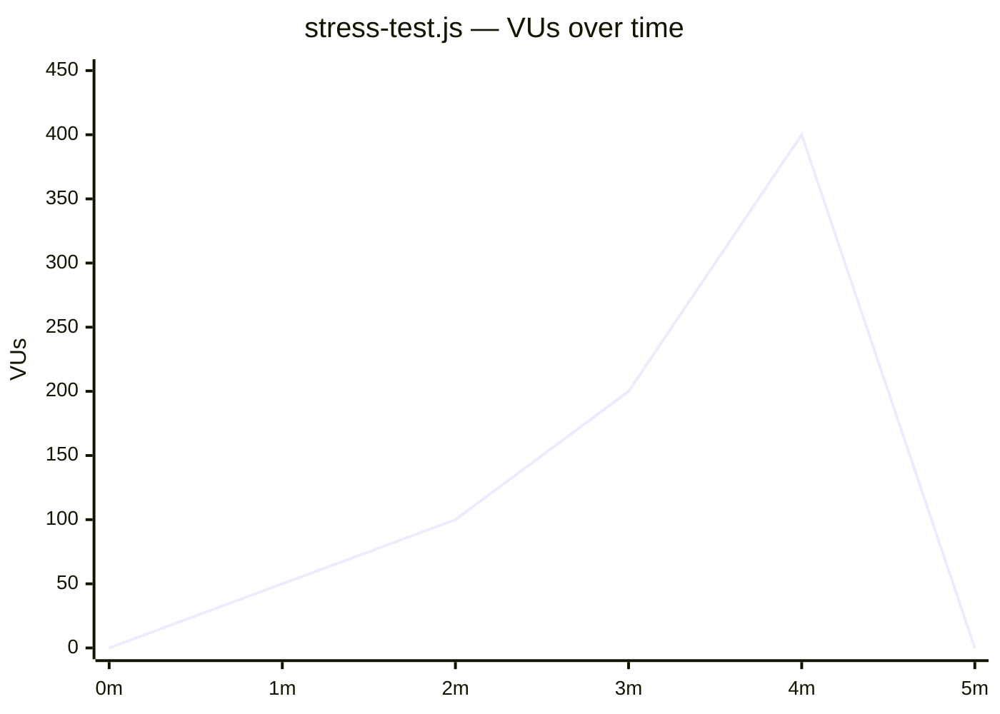
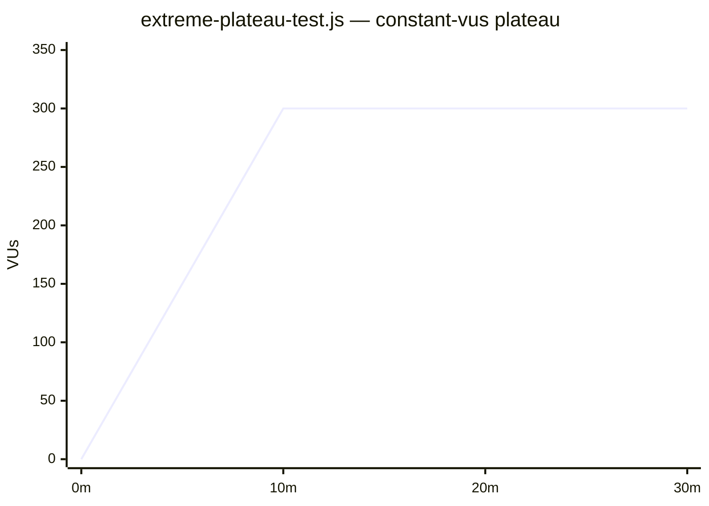
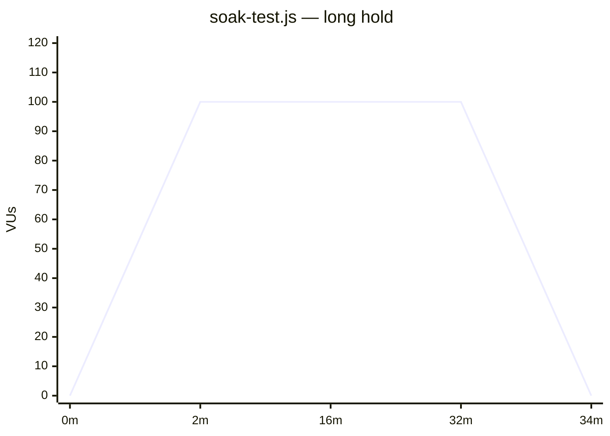
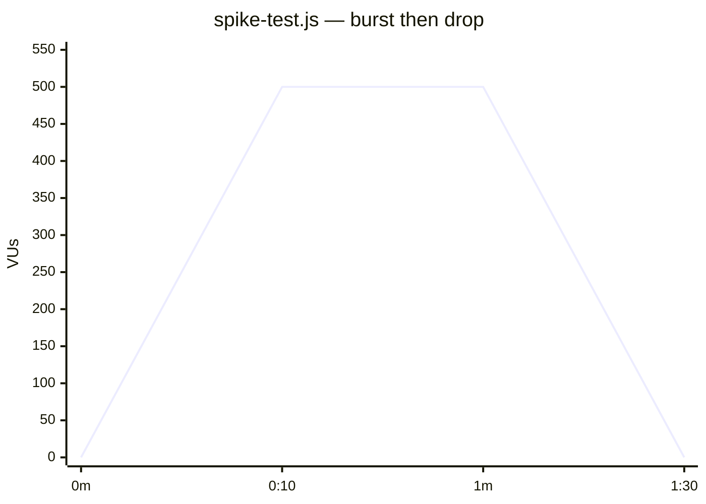
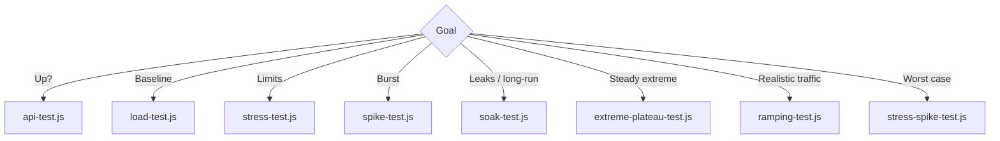
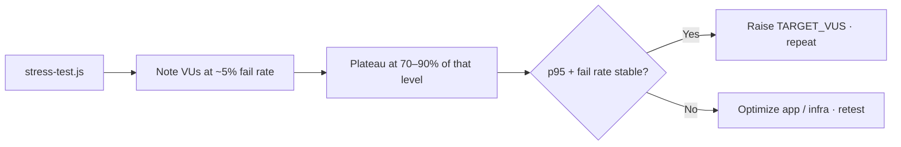

# Test Suite Reference

**Suite version**: 2.1.0


> ⚠️ **Authorized use only** — test only systems you own or have explicit permission to test. See [README](../README.md#disclaimer--authorized-use-only).

Every script lives under `tests/` and shares `src/config.js` + `src/helpers.js`.
All scripts honor `BASE_URL`, `TIMEOUT`, think-time vars, and `SKIP_TLS_VERIFY` (default `true`).

Examples below use dummy hosts (`app.example.com`, `target.example.com`) and documentation IPs (`192.0.2.10`).

---

## At a glance

| Script | Profile | Peak VUs | Duration | Thresholds |
| --- | --- | --- | --- | --- |
| `api-test.js` | load | 10 | 30s | p(95)&lt;500ms, fail&lt;1% |
| `load-test.js` | load | 20 | ~2m | p(95)&lt;500ms, p(99)&lt;1000ms, fail&lt;1% |
| `stress-test.js` | stress | 400 | ~5m | p(95)&lt;2000ms, p(99)&lt;5000ms, fail&lt;5% |
| `spike-test.js` | spike | 500 | ~1.5m | p(95)&lt;5000ms, fail&lt;10% |
| `soak-test.js` | soak | 100 | ~34m | p(95)&lt;2000ms, p(99)&lt;5000ms, fail&lt;1% |
| `ramping-test.js` | load | 50 | ~4m | p(95)&lt;500ms, fail&lt;1% |
| `stress-spike-test.js` | spike | 5000 | ~7.5m | p(95)&lt;5000ms, fail&lt;10% |
| `extreme-plateau-test.js` | extreme | adjustable | adjustable | p(95)&lt;3000ms, p(99)&lt;5000ms, fail&lt;5% |

---

## Load profiles (diagrams)

### Stress — progressive breaking point



### Extreme plateau — flat, no fluctuation



### Soak — sustained moderate load



### Spike — sudden burst



### Which script?



---

## `tests/api-test.js` — smoke / health check

- **Load profile**: flat 10 VUs for 30s
- **Checks**: status is 200, response body exists, response time &lt; 500ms
- **Use when**: CI gates, pre-deploy validation
- **Run**: `k6 run tests/api-test.js`

---

## `tests/load-test.js` — baseline ⭐

- **Load profile**: 30s ramp to 20 → 1m hold → 30s ramp down
- **Checks**: status is 200, has content, response time &lt; 5s
- **Use when**: establishing baselines, regression checks
- **Run**: `k6 run tests/load-test.js --env BASE_URL=https://app.example.com`

---

## `tests/stress-test.js` — breaking point

- **Load profile**: 1m each at 50 → 100 → 200 → 400 VUs, then 1m ramp down
- **Think time**: 0.5–2s
- **Checks**: status is 2xx
- **Use when**: finding maximum concurrent users
- **How to read**: the stage where `http_req_failed` approaches 5% is the practical limit
- **Run**: `k6 run tests/stress-test.js`

---

## `tests/spike-test.js` — sudden burst

- **Load profile**: 10s spike to 500 VUs → 1m hold → 10s drop
- **Think time**: 0.1–1s
- **Checks**: status is valid (100–599)
- **Use when**: flash sales, viral traffic, auto-scaling validation
- **Run**: `k6 run tests/spike-test.js`

---

## `tests/soak-test.js` — long-term stability

- **Load profile**: 2m ramp to 100 → 30m hold → 2m ramp down (~34m total)
- **Checks**: status is 200, has content, status is 2xx
- **Uses**: `http.batch` for realistic asset loading
- **Use when**: memory leaks, connection exhaustion, slow degradation
- **Run**: `k6 run tests/soak-test.js`

> Tip: smoke long soaks first with a short custom stage list before committing to 34 minutes.

---

## `tests/ramping-test.js` — realistic traffic

- **Load profile**: 1m ramp to 50 → 2m hold → 1m ramp down
- **Checks**: status is 200, response time acceptable (&lt; 2000ms)
- **Use when**: business-hours style multi-stage patterns
- **Run**: `k6 run tests/ramping-test.js`

---

## `tests/stress-spike-test.js` — chaos hybrid

- **Load profile**: 30s→500, 1m→1000, 2m→3000, 1m→5000, 3m hold 5000, 30s→0
- **Threshold profile**: `spike`
- **Behavior**: batched GET + cache-buster query per iteration
- **Warning**: 5000 VUs needs K6 Cloud or a high-end generator
- **Run**: `k6 run tests/stress-spike-test.js`

---

## `tests/extreme-plateau-test.js` — flat extreme load

- **Load profile**:
  - `RAMP_IN=0` (default): k6 `constant-vus` — VUs pinned at `TARGET_VUS` for `EXTREME_DURATION`
  - `RAMP_IN>0`: brief ramp-in, then flat hold (no mid-test fluctuation, no ramp-down)
- **Env knobs**:

| Variable | Default | Meaning |
| --- | --- | --- |
| `TARGET_VUS` | `300` | Plateau VU count (integer ≥ 1) |
| `EXTREME_DURATION` | `10m` | Hold time (`\d+(ms|s|m|h)`) |
| `RAMP_IN` | `0s` | Optional entry ramp |

- **Checks**: status is 2xx, has content
- **Logging**: setup banner + per-VU heartbeat every 25 iterations
- **Think time**: 0.2–0.8s
- **Use when**: measuring stability **at** extreme load without ramp noise
- **Run** (Linux / macOS / Git Bash):

```bash
k6 run tests/extreme-plateau-test.js \
  --env BASE_URL=https://app.example.com/ \
  --env TARGET_VUS=300 \
  --env EXTREME_DURATION=15m
```

```powershell
# Windows (PowerShell)
k6 run tests/extreme-plateau-test.js `
  --env BASE_URL=https://app.example.com/ `
  --env TARGET_VUS=300 `
  --env EXTREME_DURATION=15m
```

### Choosing a plateau level



---

## Shared run patterns

```bash
k6 run --env-file=.env tests/load-test.js
k6 run tests/stress-test.js --env BASE_URL=https://app.example.com --env SKIP_TLS_VERIFY=false
k6 run tests/load-test.js --out json=results.json
```

Related: [CONFIGURATION.md](./CONFIGURATION.md) · [QUICK_REFERENCE.md](./QUICK_REFERENCE.md) · [../CHANGELOG.md](../CHANGELOG.md)
